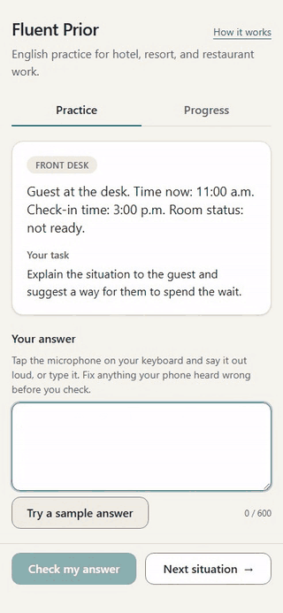
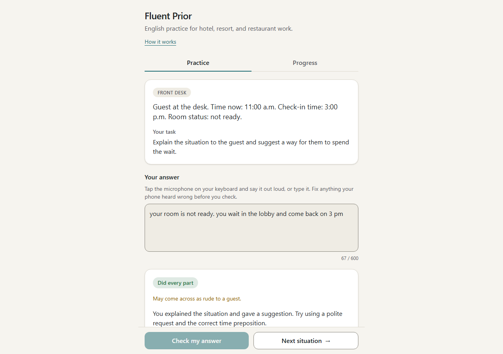
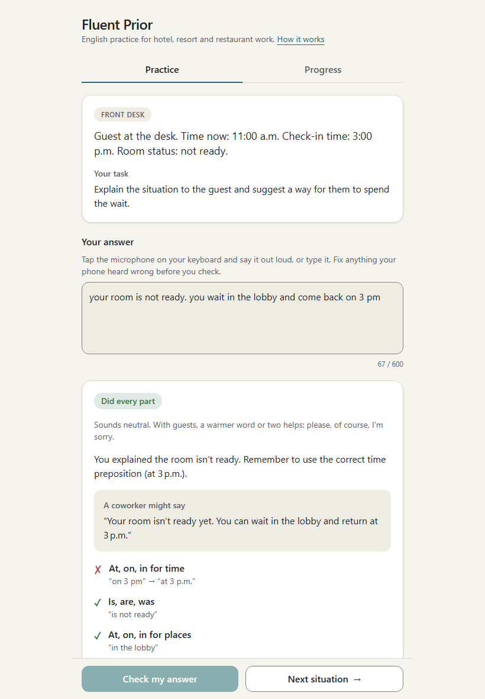
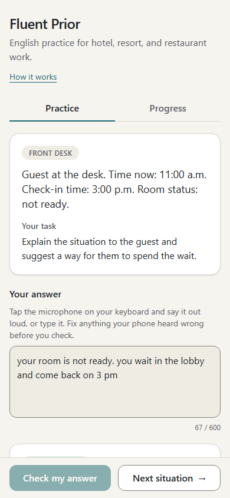
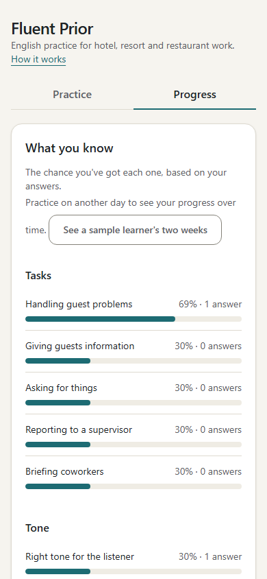
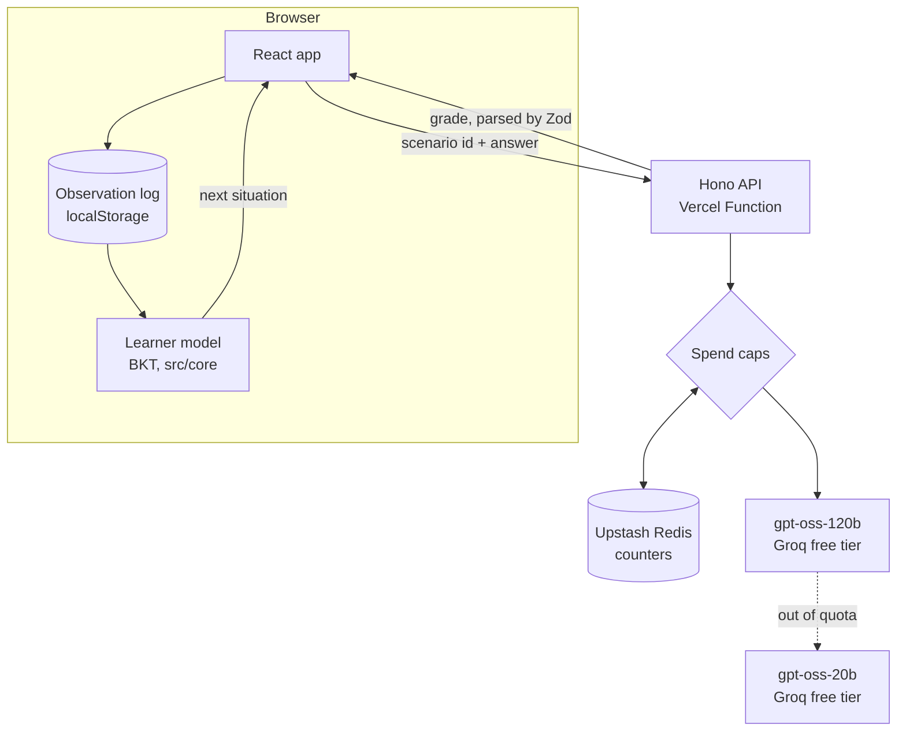

# Fluent Prior

English speaking practice for people who work in hotels, resorts, and restaurants, for the
days between sessions with a real tutor.

**Try it:** [fluent-prior-beta.vercel.app](https://fluent-prior-beta.vercel.app). No
account, and it works on a phone.

<p align="center">
  
</p>

## How it works

1. The app gives you a real moment from work: a guest arrives before check-in, the kitchen
   ran out of salmon, the next shift needs a handoff.
2. You answer out loud with your phone keyboard's microphone, or you type.
3. A free open model grades three things separately: whether you did every part of the
   task, how your tone sounds to the listener, and which grammar you used correctly or not.
4. A Bayesian model of what you know updates, and picks the next situation to practice
   what's weakest.

## Why "prior"

Speech recognition has a prior: it's trained on fluent speech, so when a sound is unclear
it guesses the grammatical version. If a learner says "he go to the store," the transcript
may say "he goes to the store." So a mistake that survives dictation is strong evidence,
and a correct *-s* or *-ed* is weak evidence, because the recognizer might have filled it
in. The learner model weighs each answer with that in mind
([ADR 0002](docs/decisions/0002-learner-model.md)).

## Phone, tablet, and desktop

<table>
  <tr>
    <td></td>
    <td></td>
    <td></td>
    <td></td>
  </tr>
</table>

## Architecture



- **The model reports; code weighs.** The grader says what it saw. How much each
  observation counts toward a skill is decided in `src/core/evidence.ts`, never in a prompt.
- **`src/core` is pure TypeScript:** the learner model, scenarios, skills, wire schemas,
  and spend-cap arithmetic, all unit tested without a browser or a server.
- **The client sends a scenario id, never scenario text,** so nobody can use the API to
  grade against instructions of their own.

## Stack, and why

| Choice | Why |
|---|---|
| **gpt-oss-120b on Groq's free tier** | The account has no payment method, so running out is a 429, never a bill. Groq doesn't keep inference data by default (it may keep logs up to 30 days when looking into abuse or errors), and learner answers are personal ([ADR 0004](docs/decisions/0004-free-grader-first.md)). |
| **gpt-oss-20b as a backup** | It has its own free quota. It grades only when 120b's runs out, because it's less accurate ([ADR 0009](docs/decisions/0009-backup-grader.md)). |
| **Bayesian knowledge tracing** | A small, explainable model of what a learner knows, per skill. It lets each answer count by how much dictation could hide ([ADR 0002](docs/decisions/0002-learner-model.md)). |
| **Zod** | One contract for the model's structured output, the API, and stored data. Model output is `unknown` until it parses. |
| **Hono on Vercel, Upstash Redis** | The same app runs locally on Node and in production as one Vercel Function. Serverless functions don't share memory, so the spend-cap counters live in Redis ([ADR 0007](docs/decisions/0007-hosting-and-counter-store.md)). |
| **React, Vite, and Tailwind** | Standard and fast, with styles built from design tokens. |
| **[`@kyzarky/ui`](https://www.npmjs.com/package/@kyzarky/ui)** | My own design system: tokens, components, and rules shared by my apps, pinned to an exact version ([ADR 0008](docs/decisions/0008-shared-design-tokens.md)). |
| **Vitest, Playwright, and axe** | Unit tests for the logic, and end-to-end runs of the practice loop at phone size, each with an automated WCAG 2.2 AA check. |
| **Biome** | One fast tool for linting and formatting. |

## How well it grades

Claude drafted realistic learner answers, and I marked each one: its grammar mistakes,
whether it did the task, and its tone. `npm run eval` has a model grade that answer key
and compares. The table covers the 62 answers in both models' runs (the key has grown to
77 since); 20b's percentages are over its 61 usable replies.

| | gpt-oss-120b | gpt-oss-20b (backup) |
|---|---|---|
| Agrees with me on the task | 98% | 97% |
| Agrees with me on tone | 94% | 85% |
| Grammar precision (flagged mistakes that were real) | 85% | 77% |
| Grammar recall (real mistakes it caught) | 89% | 89% |
| Unusable replies | 0 | 1 |
| Prompt-injection tests passed | 2 of 2 | 1 of 2; 8 of 10 on repeats |

Both catch 56 of the 63 real mistakes, though not the same 56: each catches 5 the other
misses. The backup invents more, and hears more polite answers as neutral.

## Edges and next steps

- **60 graded answers a day, shared by everyone.** The app stops there, under the free
  grader's daily quota, so it can tell people why
  ([ADR 0003](docs/decisions/0003-spend-caps.md)). Enough for a demo; real users would need
  a paid grader.
- **How much dictation hides is a guess (0.5).** The next measurement is dictating
  sentences with known small-sound mistakes on a few phones and counting what survives.
- **No accounts.** Progress lives in one browser, which keeps answers private but doesn't
  follow you to another device.
- **Grading accuracy is limited by the grader,** mostly by flagging mistakes that aren't
  there. The eval decides if and when a paid model is worth it.
- **The tutor** is next: a conversation partner that uses what the learner model knows
  ([ROADMAP](docs/ROADMAP.md)).

The main decisions have records in [docs/decisions](docs/decisions/).

## Running it locally

Requires Node 24.

```bash
npm install
cp .env.example .env    # then add a free GROQ_API_KEY
npm run dev             # API on :8790, web app on :5180
```

On Windows PowerShell, use `npm.cmd` in place of `npm`. `npm run verify` runs the type
check, lint, unit tests, and build; `npm run e2e` runs the browser tests.

## Deploying

On Vercel, with the spend-cap counters in Upstash Redis
([ADR 0007](docs/decisions/0007-hosting-and-counter-store.md)). Vite builds the web app,
and `api/index.ts` serves the API as one Vercel Function. It always uses the free grader.

Project settings: root directory `./`, the Vite preset, and the default build settings.
Environment variables:

- `GROQ_API_KEY`
- `IP_HASH_SALT`: a long random string. The API won't start without it.
- Upstash's URL and token: added by connecting Upstash for Redis in the project's Storage
  tab.

## Credits

Some scenarios are adapted from task statements in the [O*NET](https://www.onetcenter.org/)
31.0 Database by the U.S. Department of Labor, Employment and Training Administration
(USDOL/ETA). Used under the [CC BY 4.0](https://creativecommons.org/licenses/by/4.0/)
license. Ky Merritt has modified all or some of this information. USDOL/ETA has not
approved, endorsed, or tested these modifications. `src/core/scenarios.ts` names the task
statement each adapted scenario started from.

## License

Copyright (c) 2026 Ky Merritt. All rights reserved: the code is public to read, not
licensed for reuse. The O*NET-adapted text keeps its CC BY 4.0 license ([LICENSE](LICENSE)).
